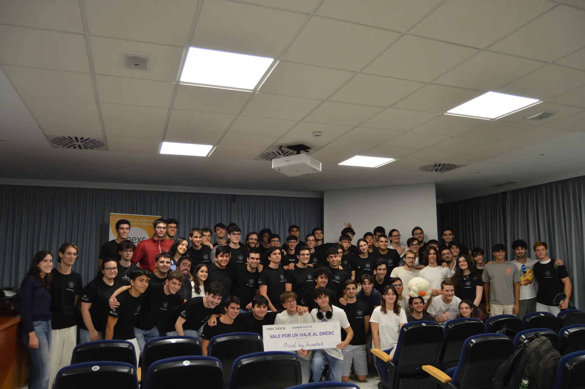
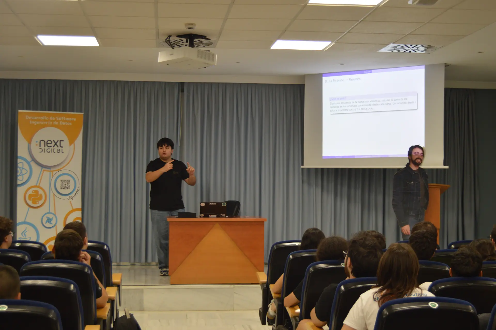

El pasado viernes 9 de octubre tuvo lugar la sexta edición de **CompliCAUS**, la competición de programación organizada por el Club de Algoritmia de la Universidad de Sevilla.

La competición reunió a **105 participantes de forma presencial** en la Escuela Técnica Superior de Ingeniería Informática de la Universidad de Sevilla y a otras **39 personas en modalidad online**, con una clasificación independiente.

Durante cuatro horas, los equipos, formados por tres integrantes, se enfrentaron a problemas de algoritmia de distintos niveles de dificultad.

# Desarrollo de la competición

La competición se desarrolló durante cuatro horas utilizando **Virtual Judge** como plataforma. Los equipos tuvieron que organizarse para resolver problemas de dificultad creciente, poniendo a prueba tanto sus conocimientos de algoritmia como su capacidad para trabajar en equipo y gestionar el tiempo.

La participación presencial reunió a estudiantes de la **Universidad de Sevilla**, la **Universidad Complutense de Madrid (UCM)**, la **Universidad Autónoma de Madrid (UAM)**, el **Centre de Formació Interdisciplinària Superior (CFIS) de la UPC**, la **Universidad Tecnológica de Eindhoven**, la **Universidad de Cádiz** y la **Universidad Pablo de Olavide**.

A ellos se sumaron 39 participantes online, que compitieron en una clasificación independiente.

# Resolución de problemas

Una vez finalizadas las cuatro horas de competición, **Kenny Flores, Pablo Reina, Pablo Moreno y Víctor Mesa**, responsables del CAUS, explicaron los puntos clave de los problemas planteados y las estrategias empleadas para resolverlos.

# Entrega de premios

Tras la resolución de problemas tuvo lugar la entrega de diplomas y premios.

### ✈️ Premio SWERC: Proof by Accepted

- **Guillermo Guerrero Serrano** (Grado en Matemáticas)
- **Alejandro Barroso Alonso** (Grado en Matemáticas)
- **José Luis Mesa Solano** (Doble Grado en Física y Matemáticas)



### 🥇 Medalla de oro: Mesopotámicos

- **Alex Pérez Fernández** (Doble Grado en Matemáticas e Ingeniería Informática)
- **Enrique Dávila Alcalá** (Grado en Ingeniería Informática - Inteligencia Artificial)
- **Daniel Chaves Mariscal** (Doble Grado en Matemáticas e Ingeniería Informática)



### 🥈 Medalla de plata: pequeños demoniO(S)

- **Lester Adrián Arencibia Arteaga** (Grado en Ingeniería Informática)
- **Raúl Alemán Rubiales** (Grado en Ingeniería Informática)
- **Carlos Sibon González** (Grado en Ingeniería Informática)



### 🥉 Medalla de bronce: J++

- **Jairo Serrano Picón** (Doble Grado en Estadística y Matemáticas)
- **Jesús Racero San Román** (Grado en Ingeniería Informática - Ingeniería del Software)
- **Julio Ojeda Infantes** (Máster Universitario en Matemáticas)



# Agradecimientos

Desde el CAUS queremos agradecer a todas las personas que participaron y colaboraron en la organización del CompliCAUS VI.

Agradecemos también el apoyo de nuestros patrocinadores **Next Digital**, **JetBrains** y la **Escuela Técnica Superior de Ingeniería Informática de la Universidad de Sevilla**, cuya colaboración hizo posible la celebración de esta edición.

Next Digital patrocinó el primer premio, JetBrains colaboró con varios de los premios de la competición y la ETSII proporcionó la comida y las camisetas para los participantes.






